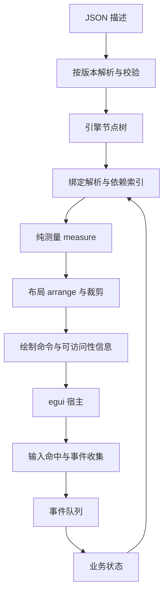

# 自研底层组件设计与持续开发路线

状态：设计基线及实现对照。适用项目：独立 desktop-app-engine。
2026-10-13 已新增独立 0.2 静态 Dashboard 路径；以下设计仍包含后续路线，不能将全部设计视为已验收。正式字段、默认值和限制以 [协议](05-description-format.md)、[schema](description-0.2.schema.json) 为准；实现、取舍及实测见 [实施记录](09-component-implementation.md)。0.1 保留原路径，P7 未实施。

## 1. 目标与实现边界

引擎接收 JSON，独立完成布局、组件绘制、交互、数据绑定与动作派发；描述来源可以是人工、脚本或其他项目。
布局、容器、指标、表格和图表均在引擎内部实现，不接入 egui_taffy、taffy、egui_tiles、egui_extras、egui_plot 等扩展包。
保留 egui/eframe 0.31.1 作为窗口、输入、字体排版、图元绘制和 AccessKit 接口的宿主。
自研组件可使用 egui 的 Painter、文本测量、矩形裁剪与交互区域，不使用现成表格、图表、复杂布局组件代替实现。
输入框初期继续复用 TextEdit 的中文输入、光标和文本编辑能力，外围尺寸、样式、绑定与事件由引擎管理。
重新实现字体栅格化、IME、OpenGL 后端和完整文本编辑器属于另一项工程，不纳入组件开发路线。

优先实现可测量、可组合、可绑定的组件系统，以 Dashboard 验证通用能力。当前最佳取舍是有限布局规则与明确组件契约；不声称未经实现和实测的算法已达到性能最优。

## 2. 当前基线与必须保持的行为

| 已有实现 | 位置 | 后续约束 |
| --- | --- | --- |
| 五种组件、字符串状态、literal/state 属性 | src/protocol/v01/ | 0.1 独立解析，禁止向其中静默加入字段 |
| JSON 类型解析、严格字段与语义校验 | src/protocol/、src/compiler/ | 错误继续包含字段路径、ID 和原因 |
| 输入快照、动作队列、set/concat | src/runtime/ | 快照及顺序写入语义保持 |
| 递归即时布局与绘制 | src/renderer/legacy.rs | 逐步替换内部实现，先验证等价行为 |
| 系统字体、系统主题、单次布局通道 | src/renderer/、src/main.rs | 中文和亮暗主题保持；测量不能触发动作 |
| 应用定义编译进 EXE | docs/06-packaging-decision.md | 每次导出编译对应定义，客户机无制作工具 |

核心行为回归使用内联描述和临时目录，验证解析、作用域、状态、事件及业务界面。只验证 --check 不代表 GUI 已验收，无窗口绘制也不代替客户机视觉和交互检查。

## 3. 参考项目中提炼的逻辑与取舍

本节依据公开源码或官方文档，算法细节中标注的“本引擎选择”是设计决策，不冒充上游实现。

| 来源 | 查阅依据 | 提炼的逻辑 | 本引擎选择 |
| --- | --- | --- | --- |
| Taffy | 节点的 Style/Layout、measure 回调、缓存接口 | 树与布局输入输出分离；叶节点提供测量 | 自建 arena 节点树与约束布局，先实现受限 flex 和网格 |
| egui_taffy | 布局桥接及多通道测量说明 | 文本受宽度约束，测量与最终位置需要协调 | 用无副作用 measure/arrange，避免重绘重复执行动作 |
| egui_tiles 0.12 | Tile/Container/Pane、Shares | 容器与叶节点分离，尺寸权重表达比例 | 初期实现权重分配；拖拽停靠延后 |
| egui_extras 0.31.1 table.rs | TableState、Column、TableBody::rows | 表头与表体共享列宽、列宽状态、可见行区间 | 自研列宽计算和固定行高虚拟表格，不扫描所有行测量 |
| egui_plot 0.32.1 | PlotTransform、PlotMemory、PlotItem | 坐标变换、图表交互状态、数据系列分离 | 自研线性坐标、刻度、折线/柱状及屏幕命中 |
| egui | Widget、Painter、交互区域、可访问性信息 | 分配区域、交互、绘制和响应边界 | 封装绘制适配层，统一 ID、裁剪、角色与焦点 |
| Slint | 声明式组件、属性绑定与运行时分层 | 描述和执行分离，绑定更新驱动界面 | 参考分层，不引入 Slint 或转换成 .slint |
| Serde / JSON Schema / Schemars | 类型化解析与 schema 描述 | 结构契约可以供不同项目消费 | 继续 Serde；手写并版本化 schema，暂不引入生成包 |
| Tokio | 后台任务和消息交付模式 | I/O 与 GUI 线程分离 | 先用标准库工作线程与有界消息通道；SSH/HTTP 单独设计 |

参考代码默认只用于理解思路。本次没有复制第三方源码；后续若移植具体代码，必须记录上游版本、文件、修改和许可证，保留所需版权/许可文本，新增 THIRD_PARTY_NOTICES.md。重新表述算法不等于可以删除被移植代码的许可。

## 4. 核心架构：保留节点树，按需绘制



节点描述在加载时构建一次，布局结果和本地交互状态按 ID 保存；每帧绘制可见内容。第一阶段保留简单全树布局，缓存和增量失效在测量正确后增加。
同一帧流程：接收后台结果 → 解析需要更新的绑定 → 布局 → 按图层注册交互并绘制 → 按输入顺序提交事件 → 更新状态并申请重绘。
measure 与 arrange 可以重复计算，但禁止更新业务状态、触发动作或启动任务。
paint 只读取已解析属性和布局；文本输入宿主产生的变更转为事件，在提交阶段更新业务状态。

### 4.1 节点模型和组件实现接口

建议使用 Vec<Node> arena 和内部 NodeId 索引，避免递归 trait 对象、重复拥有组件树和每帧克隆全树。
Node 包含外部 id、父节点、子节点索引、组件枚举、布局样式、视觉样式和事件引用；NodeId 不写入 JSON。
外部 id 必须全树唯一，内部映射不以哈希值作为唯一性依据。

组件统一实现以下职责（接口草案，不是当前可调用 API）：

| 操作 | 输入 | 输出 | 副作用 |
| --- | --- | --- | --- |
| validate | 描述、状态类型、引用索引 | 诊断 | 无 |
| resolve | 属性、业务状态、行上下文 | 强类型属性及版本号 | 无 |
| measure | 属性、宽高约束、文本测量器 | min/preferred 尺寸 | 仅测量缓存 |
| arrange | 分配矩形、子节点测量结果 | 布局矩形、内容边界、裁剪 | 仅布局结果 |
| paint | 属性、布局、本地状态、主题 | 图元和可访问性描述 | 无业务副作用 |
| input | 输入帧、交互区域、本地状态 | UiEvent | 可更新焦点/拖拽本地状态 |

采用枚举和模块函数进行静态分派；等有第三方插件需求时再评估注册表。第一版无需为未来插件引入动态装载。

### 4.2 三类状态

- 业务状态：JSON 初始值和动作结果，可被组件绑定，例如 cpu、rows。
- 组件本地状态：滚动位置、选中行键、列宽、图表视口、焦点；由外部组件 id 加子项稳定键索引。
- 派生缓存：文本排版、布局、列宽前缀、图表降采样结果，允许丢弃并重建。

状态变化区分 paint、layout、data 失效。字体、DPI、约束或内容影响 measure；颜色变化只影响 paint。
缓存键至少包含节点 id、内容版本、约束、字体版本、样式版本；不得只按 id 缓存。

## 5. 自研布局规范

### 5.1 坐标、约束与盒模型

逻辑单位统一使用 point，DPI 仅在后端转换成物理像素。尺寸必须有限且非负，min <= max。
Constraint 使用有限上界或明确的 Unbounded 枚举；不能把无穷或 NaN 传入绘制图元。
节点分配尺寸为 border-box：内容区域 = 分配区域 - border - padding。初期只提供 padding 与 gap，不引入 margin 折叠。
宽高策略：auto、fixed、fill；fill 对应正权重，fixed 指逻辑 point。min/max 与 stretch 共同约束最终尺寸。
auto 测量时若父轴无界，fill 子节点退化为 preferred 内容尺寸，避免父子尺寸循环。
隐藏节点不布局也不命中；disabled 保留布局但不产生交互事件；透明度不改变命中规则。

### 5.2 行列与受限 flex

主轴可用长度 A、子节点数 n、间距 g、基准尺寸 b_i：

```text
free = A - g * max(n - 1, 0) - sum(b_i)
```

正空间按 grow 权重分配；负空间按 shrink_i * b_i 分配，fixed 默认 shrink=0。
分配后超出 min/max 的节点冻结，剩余空间在未冻结节点中重新分配，直到收敛或全部冻结。
如果 sum(min_i)+gap 仍超过 A，保留最小尺寸并按容器 overflow 处理，禁止产生负尺寸。
wrap 行先按基准尺寸贪心分行，再逐行分配；单个超宽子项自成一行。列初期不提供换列。
交叉轴支持 start/center/end/stretch；主轴支持 start/center/end/spaceBetween。空子树返回零内容尺寸加 padding/border。
文本获得最终宽度后重测高度，更新行高；每轮只缩减待定项并设置有限测量预算，避免互相依赖无限迭代。
布局结束按边界坐标进行像素对齐，不能分别四舍五入每个宽度导致累计缝隙。

### 5.3 网格

初期固定列数，列宽支持 fixed 与 fr 权重；行高取该行子节点所需最大高度，也可 fixed。
先扣除固定轨道与 gap，再为 fr 分配剩余空间；沿用 min/max 冻结算法。顺序按 JSON children 行优先放置。
跨列、跨行和自动定位延后；初期 schema 不接受 span，避免“声明支持却渲染忽略”。
可选 autoColumns 后续使用 floor((contentWidth+gap)/(minCellWidth+gap))，最少一列并设置列数上限。
Grid 用于卡片排版；Table 单独实现数据虚拟化，不能把每一行作为常规节点插入全树。

### 5.4 裁剪与滚动

clip = 父 clip 与本节点 viewport 的交集；命中测试必须检查相同 clip。
overflow 支持 clip、scroll；初期滚动条采用固定保留槽，避免滚动条出现与否引发尺寸震荡。
绘制位置 = 内容原位置 - scrollOffset；滚动范围 clamp 到 [0, max(contentExtent - viewportExtent, 0)]。
滚轮从最深可滚动区域开始消费，到边界后剩余滚动交给父容器。拖拽时保留 pointer capture，离开矩形也能继续拖动。
图表内滚轮缩放必须显式启用，启用时在图表命中区域优先消费；否则滚动交给页面。

## 6. 绘制、主题与事件

PaintBackend 只暴露矩形、线段、路径、文本、裁剪和可访问性节点；组件不直接持有 GUI 窗口或全局状态。
egui 适配层统一逻辑坐标和 Painter 调用，避免每个组件自行创建不一致的 clip 或重复分配布局空间。
引擎计算固定区域后，宿主只登记该区域，不再用 horizontal/vertical/Grid 重新决定位置。
绘制顺序：背景 → 边框 → 内容 → 交互反馈 → overlay。弹出层通过显式图层排序，命中从顶层向下查找。

主题使用语义 token：surface、surfaceRaised、textPrimary、textMuted、border、accent、success、warning、danger、focus。
默认随系统亮暗主题，--theme 保持现有行为；主题提供完整 palette，组件不得写死亮色文字背景组合。
所有交互组件有焦点、disabled、hover、pressed 和键盘路径；表格提供选中行与单元格文本，图表提供标题、系列名和可读数据摘要。
使用与 egui 0.31.1 对应的可访问性 API，不能直接复制最新文档中的 Role 等不同版本名称。

事件包含 componentId、稳定 targetKey、事件类型、payload、输入事件序号和描述 generation。
一次物理输入只收集一次业务事件；布局重算不重复发事件，拖拽 move 事件与最终 commit 事件区分。
输入变更与后续点击按事件顺序提交，保证同一帧点击快照包含点击前最新输入，而不是前一帧旧状态。
组件仅声明事件引用，真正命令由动作执行层负责。隐藏或失效节点产生的过期事件丢弃。
0.1 onClick 仍映射到原动作，set/concat 仍读取触发时快照；本地滚动或图例开关不自动写业务状态。

## 7. 数据与 JSON 契约演进

### 7.1 版本边界

保留 DescriptionV01、原解析器和原校验语义。增加版本分派后，0.1 可转换为内部节点模型，但行为不能改变。
拟定 0.2 增加类型化状态、公共 layout/style/events 及新组件。未知版本和未知字段继续明确报错，不自动猜测版本。
不要仅将现有 BTreeMap<String,String> 换成 Value：0.2 要记录状态类型并校验赋值、绑定和动作。
输入框只接受字符串绑定；数字与布尔控件使用对应类型。表格接受数组对象，图表接受有限数字，不隐式解析数字字符串。

### 7.2 统一绑定和格式化

0.2 属性仍使用 literal/state。state 引用由 key 指向顶层状态，path 使用 RFC 6901 JSON Pointer，默认空串代表整个值。
例如 key=stats、path=/cpu；表格列 field 指对象属性名，图表 xField/yField 指数据项字段，不作为表达式执行。
缺字段与 null 分开处理：缺字段报诊断；显式 null 在可空字段显示空值占位。禁止默认当作 0 或空字符串吞掉类型错误。
格式化独立于值类型，提供 number/percent/text 的有限规则、精度和单位，不执行任意表达式或脚本。
schema 检查结构；唯一 ID、state 引用和 action 引用等跨节点语义继续由引擎校验，schema 不能替代它们。

### 7.3 公共字段与组件目录（拟定）

| 字段 | 规则 |
| --- | --- |
| type/id | 组件类型、全树唯一稳定身份 |
| layout | width/height 策略、min/max、padding、gap、对齐、overflow |
| style | 主题 token 引用、字号、边框宽度、圆角；公共字段统一默认 |
| visible/enabled | 布尔属性，可为 literal 或 state |
| events | 事件到 action ID 的映射，只允许该组件声明的事件 |
| 组件专属字段 | 保持有类型的直接字段，不采用任意 props 字典 |

| 组件 | 专属契约 | 首期事件 |
| --- | --- | --- |
| row/column/grid | children、列轨道/方向、布局规则 | 无业务事件 |
| panel/card | children、可选标题，使用公共样式 | 无；折叠后续支持 |
| text/button/input | 延续现有核心属性 | click/change/submit，按类型限定 |
| metric | label、数值 value、format、unit | 无 |
| badge | text、tone（有限主题语义） | 无 |
| progress | 有限数值 value，约定 [0,1]、可选 text | 无 |
| table | rows、rowKey、columns、rowHeight | rowSelect、sortChange |
| lineChart/barChart | series、xAxis、yAxis、legend、明确 height | 初期 hover 本地反馈；业务点选后续 |

### 7.4 Dashboard 描述草案

以下为早期 0.2 草案。运行时已支持该组件体系，当前契约以 [描述格式](05-description-format.md) 为准。下面草案将 progress 放入 grid，虽合法但不代表正式看板排版。

```json
{
  "schemaVersion": "0.2",
  "app": { "name": "运行状态看板", "window": { "width": 1100, "height": 760 } },
  "state": {
    "cpu": 0.42,
    "servers": [ { "id": "node-1", "name": "节点一", "load": 0.42 } ],
    "trend": [ { "time": 0, "value": 0.35 }, { "time": 1, "value": 0.42 } ]
  },
  "root": {
    "type": "column", "id": "dashboard",
    "layout": { "gap": 16, "padding": 16, "overflow": "scroll" },
    "children": [
      {
        "type": "grid", "id": "metrics", "columns": [ { "fr": 1 }, { "fr": 1 } ],
        "layout": { "gap": 12 },
        "children": [
          {
            "type": "card", "id": "cpu-card",
            "layout": { "padding": 12 },
            "children": [
              { "type": "metric", "id": "cpu", "label": { "kind": "literal", "value": "CPU 使用率" }, "value": { "kind": "state", "key": "cpu" }, "format": { "type": "percent", "precision": 1 } }
            ]
          },
          {
            "type": "progress", "id": "cpu-progress", "value": { "kind": "state", "key": "cpu" }
          }
        ]
      },
      {
        "type": "lineChart", "id": "cpu-trend",
        "layout": { "height": { "fixed": 240 } },
        "series": [ { "id": "cpu-series", "name": "CPU", "data": { "kind": "state", "key": "trend" }, "xField": "time", "yField": "value" } ],
        "xAxis": { "scale": "linear" }, "yAxis": { "scale": "linear", "min": 0, "max": 1 }
      },
      {
        "type": "table", "id": "server-table",
        "layout": { "height": { "fixed": 280 } },
        "rows": { "kind": "state", "key": "servers" }, "rowKey": "id", "rowHeight": 32,
        "columns": [
          { "id": "name", "field": "name", "title": "节点", "width": { "fr": 1 } },
          { "id": "load", "field": "load", "title": "负载", "width": { "fixed": 120 }, "format": { "type": "percent", "precision": 1 } }
        ]
      }
    ]
  },
  "actions": {}
}
```

## 8. 表格实现细则

独立 TableModel、TableLayout、TableState、TablePainter。行数据按引用读取，不为每格创建常规节点。
表头与表体共享一次计算的列宽及列边界。fixed、auto、fr 使用统一轨道分配；auto 初次抽样最多 200 行，重置时才重新抽样。
用户拖拽列宽优先于 auto；列集合或类型变化时废弃不兼容缓存。边界拖拽用独立命中区和 capture，不触发行选择。
最小列宽大于视口时提供水平滚动，表头和表体保持相同 scrollX；表头不参与垂直滚动。

第一版固定行高 h，无行间 gap，用 padding 放在单元格内部；数据行数 N、scrollY=s、表体视口高 H、预取行数 k=2：

```text
start = max(floor(s / h) - k, 0)
end   = min(ceil((s + H) / h) + k, N)
rowTop(i) = bodyTop + i * h - s
totalHeight = N * h
```

只格式化和绘制 [start,end) 行；隐藏区域占用总内容高度但不创建单元格。
N=0 直接显示空状态，h<=0 在校验阶段拒绝，scrollY 随数据缩短重新 clamp。
行身份为 tableId + rowKey，rowKey 必须唯一字符串；排序筛选只改变行索引，不改变选中身份。
排序缓存按数据版本与列配置更新，初期数值/文本同类型稳定排序，null 始终在末尾，类型混合拒绝。
选中变化只发一次 rowSelect；重复点击同一行不发“变化”事件。支持键盘上下和 Enter 激活。
首期不支持可变行高、合并单元格、无限加载或可编辑单元格；这些需要前缀高度索引或独立编辑状态后再扩展。

## 9. 图表实现细则

分开定义 SeriesData、AxisRange、PlotTransform、TickGenerator、ChartState 和 ChartPainter。
数据计算用 f64，最终屏幕坐标才转 f32。线性图表数据点映射：

```text
screenX = left + (x - minX) / (maxX - minX) * plotWidth
screenY = bottom - (y - minY) / (maxY - minY) * plotHeight
```

逆变换用于 hover、拖拽与缩放；布局区域和数据范围分别保存。零宽高区域跳过绘制和命中，零跨度范围扩展到有限非零区间。
空数据显示“暂无数据”，单点画 marker；非有限值拒绝，null 作为折线断点，不连接缺测区域。
自动范围线图按有限点计算，柱图包含 0；手动 min/max 优先并严格要求 min<max。
刻度以约 80 point 的间隔估计数量，选择 1/2/5 × 10^n 步长；文字碰撞时减少刻度，禁止覆盖数据或无限生成。
先测量轴标签再分配绘图区，最多两轮调整。精度规则避免 -0、重复标签和极小值除零。
初期支持数值线性轴与分组柱图；时间格式、堆叠、对数轴、饼图和多 Y 轴后续单独定义。

折线保留输入顺序；只有明确声明 x 单调的系列才能用二分定位可见区间，否则扫描并限额。
单调 X 的密集点按屏幕像素列保留首末及 min/max，再按原索引排序输出，保留尖峰；超过预算的非单调线不适用此算法。
hover 在屏幕空间用约 6 point 容差查找点/线段；断点不参与连线命中，展示原始数据，不能把降采样代表点当作唯一数据来源。
图例显示状态和手动视口存本地状态。数据更新时：自动视口重新 fit，用户手动视口保留，reset 恢复自动。
缩放以指针对应数据点为锚，限制有限跨度；拖拽位移经逆变换调整范围，变化只影响该图表布局/绘制。
轴、数据、图例和 tooltip 的裁剪分别定义，命中区域使用同一变换；不能在图表外触发隐藏点。

## 10. 数据刷新与未来动作

新增 UI 组件不依赖 SSH/HTTP 已完成，首先用 JSON 初始状态和确定性更新动作验收。
后台工作线程返回 RequestId、目标 state、结果、generation，GUI 每帧非阻塞读取有限批次消息。
同一数据源后发请求覆盖先发，过期返回值丢弃；组件删除或应用 generation 变化也丢弃旧结果。
配置 loading/error 与数据分开保存，避免把错误字符串写进数字或数组状态；后台任务不直接操作组件。
有界队列满时采用明确的合并/拒绝策略，GUI 提交任务不得阻塞。队列容量和单帧消息预算在执行层验收时固定。
本地命令需单独定义参数数组、工作目录、stdout/stderr、退出码、超时与取消；SSH 需连接契约及输出映射。
这些是动作/数据源工作流，不能把网络访问或进程启动埋进 metric/table/chart 的 paint 方法。

## 11. 模块规划

在现有 crate 内按以下边界组织；当前实现与公开入口见 [架构](02-architecture.md)：

```text
src/
  protocol/      # v01/v02 原始描述、公共字段、绑定和结构解析
  compiler/      # 名称与作用域解析、语义校验、私有编译元数据
  components/    # 节点树、表格和图表算法
  layout.rs      # 几何、约束、布局与测量
  runtime/       # 状态提交、动作、事件与异步任务调度；保留 legacy
  services/      # 命令、HTTP、插件、凭据与日志
  renderer/      # egui 宿主、主题、文本、图表绘制和输入收集
  loader.rs      # 版本分派、应用输入路径和编译入口
  bin/vben-package/ # 构建工作台业务入口及控制器
```

基础几何、布局、刻度、虚拟区间和绑定算法不能依赖 egui::Ui；可在无窗口环境测试。绘制通过窄接口对接宿主。
首次抽取模块先保持行为等价，再增加新组件；禁止同一轮同时重写 0.1 动作和新增图表全部功能。

## 12. 实施顺序与验收门槛

下面为设计验收门槛。各阶段实际状态见 docs/09，未实测项不勾选；每阶段记录命令、输出、截图与剩余限制。

| 阶段 | 交付 | 验收 |
| --- | --- | --- |
| P0 契约 | 0.2 schema、组件字段/默认值/错误样例、完整 Dashboard JSON | 0.1 原有测试通过；0.2 草案与 schema 对齐，未实现版本继续拒绝 |
| P1 基础架构 | 节点树、几何、约束、绘制适配、ID/主题、measure/arrange | 原五种组件视觉与交互等价；连续重绘不重复动作 |
| P2 布局和容器 | 行列、受限 flex、网格、滚动、card/panel | 嵌套、最小窗口、长中文、DPI/主题变化、裁剪与命中一致 |
| P3 绑定和指标 | 0.2 类型化状态、格式化、metric/badge/progress | 类型不匹配明确报错；更新只影响相关组件；0.1 快照不变 |
| P4 表格 | 固定行高、共享列宽、虚拟化、选择与稳定排序 | 10,000 行只绘制可见行；列拖拽、表头对齐、键盘和空数据 |
| P5 图表 | transform、ticks、line/bar、hover、降采样、视口 | 空/单点/负值/常量/极值/断点；100,000 单调 X 点验证尖峰保留 |
| P6 Dashboard | 四指标、趋势图、分组柱图、明细表、状态更新 | 统一主题、缩放、长中文、更新交互及独立应用包 --check |
| P7 动态能力 | 异步刷新与命令/数据源独立契约 | GUI 不阻塞、超时/错误/取消、乱序返回测试，再扩展 SSH |

布局单元测试必须使用可手算的矩形结果：min/max 冻结、权重、换行、空容器、溢出和无界测量。
表格测试至少验证滚动末尾、数据缩短、列宽改变、排序后选中键稳定和可见行数量上界。
图表测试验证正逆变换误差、刻度有限且不重复、剪裁边界、降采样保留尖峰和断点。
测量只读、输入先于点击的快照、相同输入单次派发是事件测试重点。

性能目标是待测目标，不是承诺：参考机 release、1920×1080 下，Dashboard 交互帧 CPU P95 目标 <=16ms；表格绘制调用数随可见行而非总行数增长。
单调 X 大图降采样需在数据/视口变化时计算并缓存，记录原点数、输出点数、耗时、机器和构建版本；不能只报告“流畅”。
每阶段运行 fmt、Clippy、离线锁定测试与发布构建。GUI 截图须检查有可见文字和控件，并通过实际输入/点击验证，不仅检测像素非纯色。
不自动勾选旧 GUI 待办；完整测试权限失败与功能失败分别记录。交付产物使用编入应用定义的 EXE，制作端 JSON 修改后重新打包，详见 [分发决策](06-packaging-decision.md)。

## 13. 持续开发记录模板

后续组件开发均新增或更新组件明细文档，并链接本基线；对本设计的偏离先记录理由和影响再实现。

```text
组件/阶段：
状态：计划 / 实施中 / 已验收
协议版本与字段：必填、默认、限制、绑定类型、事件 payload
内部结构与算法：输入、输出、缓存键、复杂度、退化处理
来源：项目/版本/文件，借鉴思路或具体移植，许可证与修改
实施文件：
验收：命令、输出、退出码、GUI 操作及证据
兼容性：0.1、字体、主题、动作快照、分发
性能实测：机器/数据量/可见量/耗时
未完成项与下一步：
```

第一项实际开发应是 P0 + P1 的最小切片：固定 0.2 核心字段，建立组件矩形和只读测量，再完成一张 card 的布局绘制。用这个切片确认接口，随后实现 Grid 和其他组件。

## 14. 查阅来源

查询日期：2026-10-13。版本固定链接用于可复查；latest 链接只代表查询时资料，后续实现应记录具体版本或 commit。

- [Taffy 0.15：节点、测量与缓存接口](https://docs.rs/taffy/0.15.0/taffy/)。仅参考架构，不接入该算法库。
- [egui_taffy：布局桥接、测量与多通道说明](https://docs.rs/egui_taffy/0.14.0/egui_taffy/)。兼容表亦包含 egui 0.31 对应版本。
- [egui_tiles 0.12：树、容器与尺寸 shares](https://docs.rs/egui_tiles/0.12.0/egui_tiles/)。
- [egui_extras 0.31.1 表格源码](https://docs.rs/egui_extras/0.31.1/src/egui_extras/table.rs.html)。重点 TableState、Column、TableBody::rows。
- [egui_plot 0.32.1 模型](https://docs.rs/egui_plot/0.32.1/egui_plot/)、[PlotTransform](https://docs.rs/egui_plot/0.32.1/egui_plot/struct.PlotTransform.html)。
- [egui 自定义组件接口](https://github.com/emilk/egui/blob/main/crates/egui/src/widgets/mod.rs)、[可访问性说明](https://github.com/emilk/egui/blob/main/docs/accessibility.md)。最新 API 名称需回查 0.31.1。
- [Slint 架构与声明式属性](https://github.com/slint-ui/slint#architecture)。
- [Schemars：类型与 schema 一致性](https://docs.rs/schemars/1.2.3/schemars/)、[JSON Schema 规范](https://json-schema.org/specification)。本项目拟先手写 schema。
- [Tokio：异步运行时分层](https://tokio.rs/)。本路线先用标准库线程/消息，不新增 Tokio 依赖。
